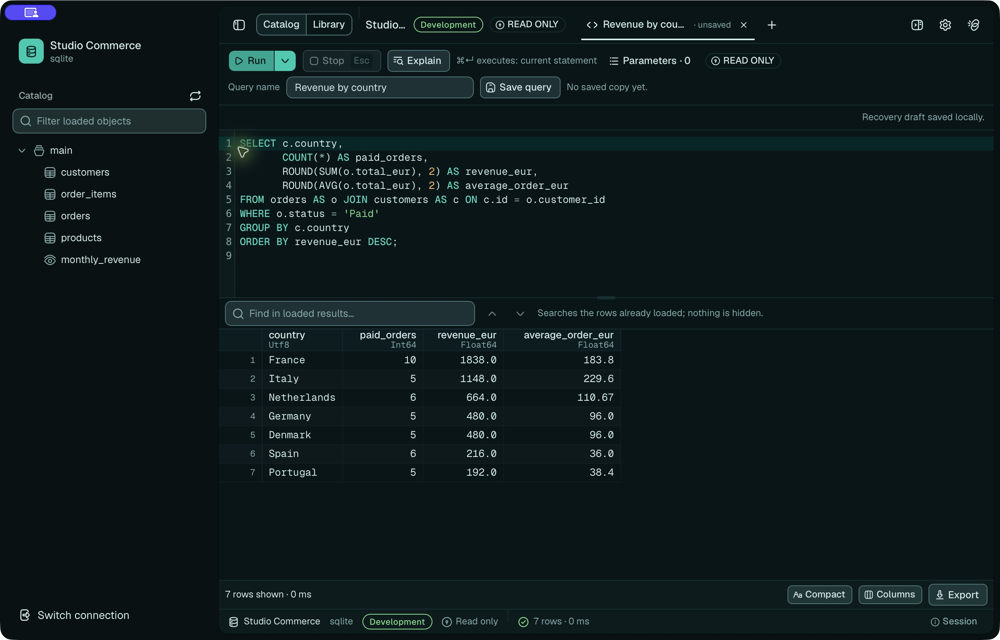

# Oxyn

A native, high-performance workspace to explore, query and manage any kind of
database — relational, analytical, NoSQL, vector, graph. AI agents help users
understand schemas and queries **alongside** them, never in their place.

Intended audience: data professionals, people who read PostgreSQL error
messages.

The scope and the principles are authoritative in [docs/VISION.md](docs/VISION.md).
The real progress is in
[docs/IMPLEMENTATION-PLAN.md](docs/IMPLEMENTATION-PLAN.md) — this README does
not duplicate it, because a copy of the progress is stale the next day.

## Interface and demos



Explore the [screenshot gallery and demo videos](assets/demo/README.md):

- [Explore a database](assets/demo/videos/explore-database.mp4): browse rows,
  inspect columns and read the table definition.
- [Run a revenue query](assets/demo/videos/run-query.mp4): execute SQL and inspect
  the results.

Recorded in **Oxyn 0.0.3 for macOS** with a temporary workspace and
[reproducible synthetic data](assets/demo/seed.sql).

For a guided tour, watch the [46-second overview](assets/demo/videos/motion/overview.mp4)
and the [animated walkthroughs](assets/demo/README.md#animated-walkthroughs), one
per feature — rebuilt from the interface components, not screen recordings.

## What the repository contains

A single Cargo workspace, whose members are `crates/*` (the core, the Tauri
application and its binary) and `drivers/*` (the protocol implementations), and
the front end of the application in `apps/desktop`. The split and the direction
of dependencies are authoritative in
[docs/ARCHITECTURE.md](docs/ARCHITECTURE.md).

## Download

Packages are attached to the
[GitHub releases](https://github.com/so-keyldzn/oxyn/releases): a DMG for Apple
Silicon macOS (13 or later), and a DEB, an RPM and an AppImage for x86_64 and
ARM64 Linux. Intel macOS and Windows are not built
([docs/RELEASE.md](docs/RELEASE.md)).

## Building

The application is Tauri 2 with a front end in `apps/desktop`
([ADR-0029](docs/adr/0029-interface-tauri-shadcn.md)). Prerequisites:

- **Rust**: the toolchain is pinned by `rust-toolchain.toml` and rustup installs
  it on the first `cargo`
  ([ADR-0008](docs/adr/0008-chaine-outils-rust.md)).
- **Node 22**: the version CI uses; the front end accepts `^20.19.0` or
  `>=22.12.0`.
- **pnpm**, at the version of the `packageManager` field of
  [apps/desktop/package.json](apps/desktop/package.json). The Makefile stops
  with a message if `pnpm` is missing, and installs the front-end dependencies
  itself (`pnpm install --frozen-lockfile`).
- **Linux only**, the system libraries CI installs before building:
  `libwebkit2gtk-4.1-dev build-essential curl wget file libxdo-dev libssl-dev
  libayatana-appindicator3-dev librsvg2-dev` (Debian and Ubuntu names, from the
  Tauri prerequisites recorded in [RESEARCH-NOTES](docs/RESEARCH-NOTES.md)).
- **`python3`**, for `make desktop PROFIL=release` and for the quality gate.

```sh
make desktop-dev              # the application with hot reload, on a temporary workspace
make desktop                  # a debug build, without a bundle
make desktop PROFIL=release   # the optimized build and its packages
```

`make desktop PROFIL=release` regenerates the third-party notices the
application ships, and refuses to build without `cargo-about` installed. The
packages land in `target/release/bundle`. The release workflow
([.github/workflows/livraison.yml](.github/workflows/livraison.yml)) runs that
same target, then signs and notarizes the macOS packages
([docs/RELEASE.md](docs/RELEASE.md)).

## The quality gate

```sh
make qualite
```

It is the **only** entry point: CI calls its targets in parallel jobs
([.github/workflows/qualite.yml](.github/workflows/qualite.yml)), the `Stop` hook
reminds of it, the definition of "done" rests on it. A check added elsewhere is
an optional check.

It chains: consistency of the steering foundation, dated `TODO`s, pinned
versions, the front end (npm licenses and advisories, format, lint, types, the
stories, the build), then the Rust (format, clippy, tests, documentation,
dependency licenses and advisories). `make aide` lists the other targets.

## Where the truth lives

| | |
|---|---|
| [docs/](docs/README.md) | the domain — vision, architecture, contracts, security, budgets, ADRs |
| [CLAUDE.md](CLAUDE.md) | the map of the repository and the thirteen invariants |
| [.claude/](.claude/README.md) | the way of working — rules, commands, agents, hooks |
| [AGENTS.md](AGENTS.md) | the equivalent entry point for Codex |
| [i18n/fr/](i18n/README.md) | French mirrors of the English documents |

**When the code and a document of `docs/` contradict each other, it is a
bug**: report it, do not settle it alone.

## Language

The repository is written in **English**: code, identifiers, comments, error
messages, `///`, documentation, ADRs, commit messages and pull requests
([ADR-0047](docs/adr/0047-english-as-the-repository-language.md)).
[`i18n/fr/`](i18n/README.md) holds French mirrors; **English is
authoritative**, and `make qualite` refuses a mirror older than its original.

## License

Copyright 2026 Nicolas Boromée.

The application is under **GPL-3.0-or-later** ([LICENSE-GPL](LICENSE-GPL)). The
four crates a third-party driver must link (`oxyn-core`, `oxyn-catalog`,
`oxyn-data` and `oxyn-driver`) are under **Apache-2.0**
([LICENSE-APACHE](LICENSE-APACHE)). A driver or plugin author therefore chooses
their own license. [NOTICE](NOTICE) says which license covers which part, and
[ADR-0044](docs/adr/0044-licence-gpl-et-contrat-apache.md) says why.

All the code in this repository is usable without an account or a subscription.
What will be paid for are optional services attached to an account, such as
hosted AI or synchronization.

An external contribution requires accepting the [CLA](CLA.md): see
[CONTRIBUTING](CONTRIBUTING.md).
