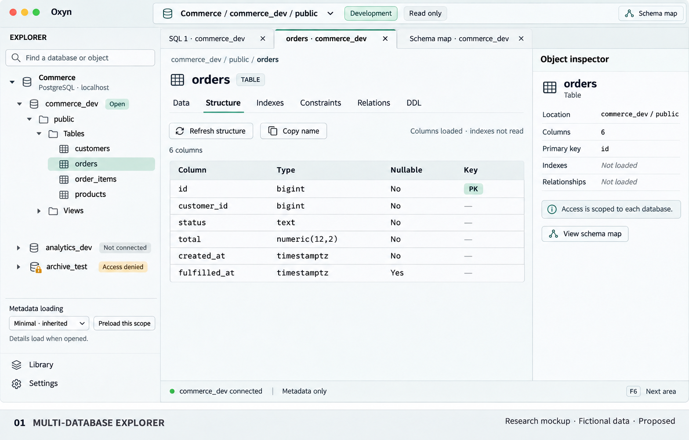
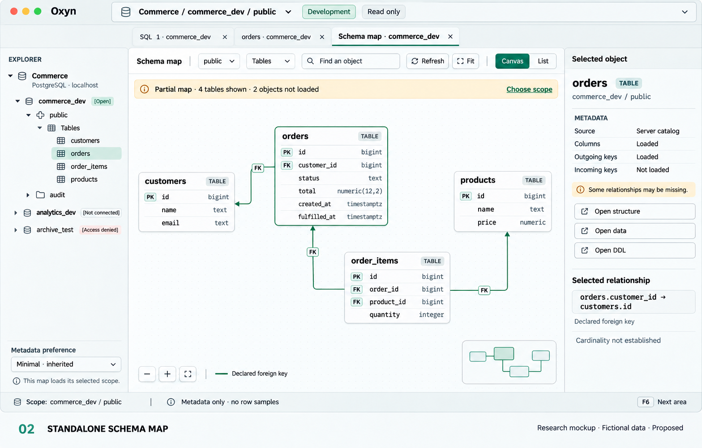

# Schema research: explorer and schema-map mockups

**Status:** proposed static design, not an implementation or accepted UI contract.
**Date:** 2026-11-13. **Repository reference:** `f456ff1`.
This appendix belongs to the [implementation plan](../IMPLEMENTATION-PLAN.md).
The [journeys](schema-research-journeys.md) and
[engine matrix](schema-research-engines.md) remain the behavioral research.

## Deliverables

| Image | Journey / proposed ADR | What to review |
|---|---|---|
| [01 — Multi-database explorer](mockups/01-multi-database-explorer-v1.png) | J01/J02/J03/J10; ADR-0080/0080 | Server grouping, independent database states, fixed tab destination and separate metadata availability |
| [02 — Standalone schema map](mockups/02-schema-map-v1.png) | J04/J06/J10; ADR-0082 | Explicit scope, typed links, partial coverage and object inspection without an AI panel |
| [03–08 — Multi-base lifecycle](schema-research-multibase-mockups.md) | J01/J02/J06/J09; ADR-0080 | Profile setup, child credentials, retained workspace switching, scoped menus, group close and cross-base insertion |

The English interface copy and all database names, objects and states are
fictional. These are image proposals, not screenshots of a running Oxyn build.
The light slate surfaces, verdigris accent and compact typography follow the
direction of [the current theme](../../apps/desktop/src/styles.css), not the
historical Figma board as an implementation source. Exact typography, icons,
spacing and contrast still need validation in the real component system.

## 01 — Multi-database explorer

- `Commerce` is a server group; `commerce_dev` is the open database.
  `analytics_dev` is not connected and `archive_test` is access denied.
  A refused child does not make the group unusable or appear as an empty base.
- The breadcrumb and tabs keep `commerce_dev` visible. The Development and
  Read only markers belong to this active connection, not every child of Commerce.
- Structure shows six columns of `public.orders`. Indexes and relationships
  are explicitly not loaded; the primary key does not imply those facets were read.
- `Minimal · inherited` is the selected namespace's inherited preference;
  `Preload this scope` is a separate action. Opening Structure still requests
  its required description.
- The map entry is reachable without configuring an AI provider. F6 is shown
  as a proposed workspace action, not evidence that it is implemented.

## 02 — Standalone schema map

- Scope is `commerce_dev / public`, with a Tables filter. Four drawn objects
  and two not loaded are fictional counts for the selected scope, not a claim
  about a real or complete database.
- Exactly three foreign keys are shown:
  `orders.customer_id → customers.id`,
  `order_items.order_id → orders.id`,
  `order_items.product_id → products.id`.
  Arrowheads point to the referenced object; no cardinality is asserted.
- The selected orders object has the same six columns as the explorer.
  The cards summarize structure; exact connector ports and field-level focus
  are interaction details to validate, not executable relationships.
- The right inspector distinguishes loaded columns/outgoing keys from unread
  incoming keys. Incoming links visible through another object's outgoing
  metadata do not establish exhaustive incoming discovery for orders.
- Canvas/List, scope choice, search, Fit and zoom are proposed controls.
  Open Data is a separate preview request; merely selecting a card reads no rows.

## Review boundary

The initial two images cover a populated light desktop layout with representative
unavailable/partial states. They do not demonstrate loading, empty, authentication,
compact/dark layouts, keyboard behavior, accessible list content, image export,
or non-relational renderers. Those remain the acceptance work in the journeys;
no new behavior is decided by an icon or a button drawn here.

The [six lifecycle additions](schema-research-multibase-mockups.md) now illustrate
credential entry, an empty console, activation, scoped menus and close/drop
reviews. They remain static proposals, not execution or accessibility tests.

The screens share a target and visual direction; panels have different widths
to give the map more canvas space. Raster generation is not a pixel-exact token
or Hugeicons implementation. Visual inspection checked hierarchy, target names,
six-column consistency, the three links, partial-state wording and readable panels.
No application code or real database was used.

## Generation record

Created with the built-in `image_gen` tool after Pencil's application transport
was unavailable. The [exact generation and selected-edit prompts](mockups/generation-prompts.txt)
are retained as English tool inputs, including the roles of reference images.
The original generated files remain outside the repository; only the two
selected PNG deliverables are copied here. No HTML, React, SVG program or
interactive prototype was created.
