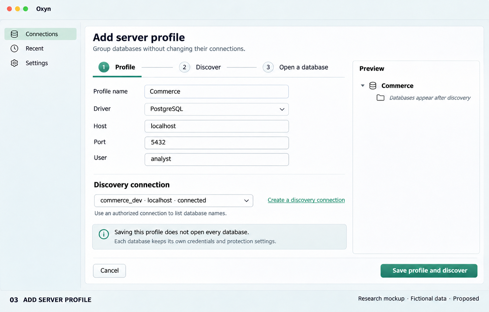
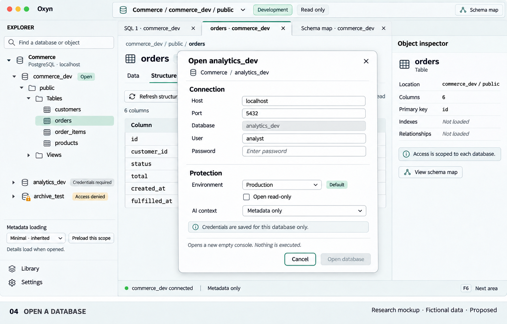
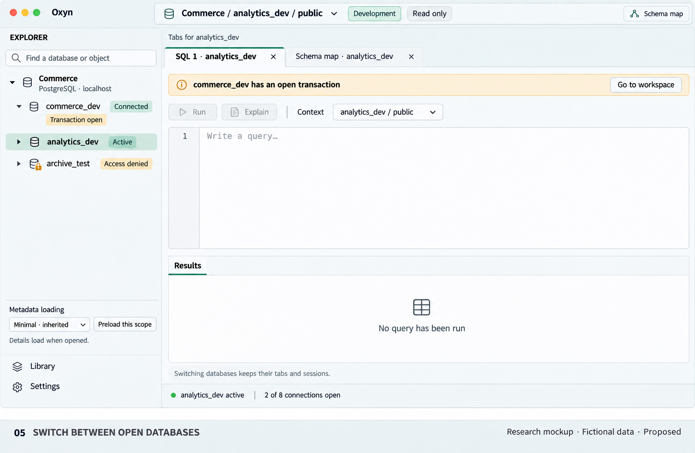
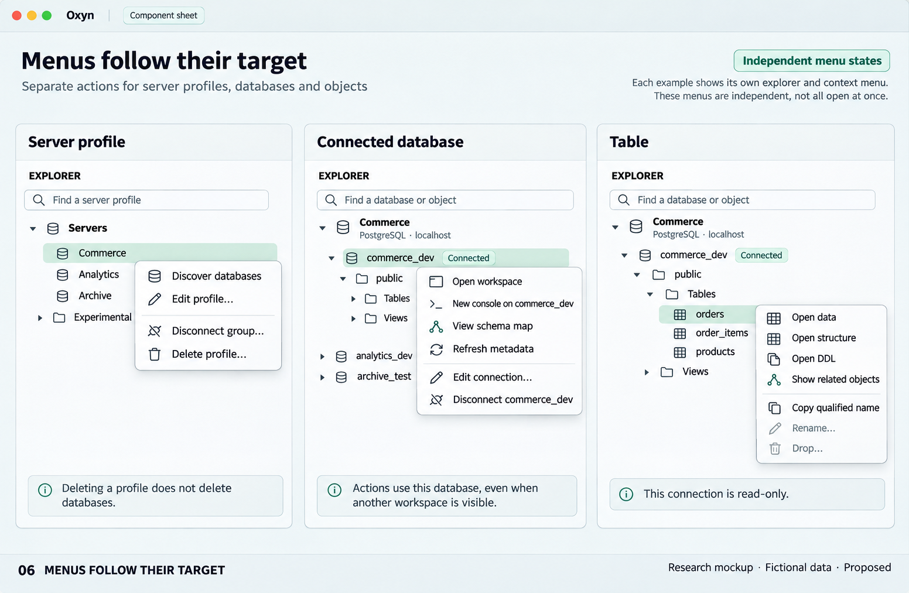
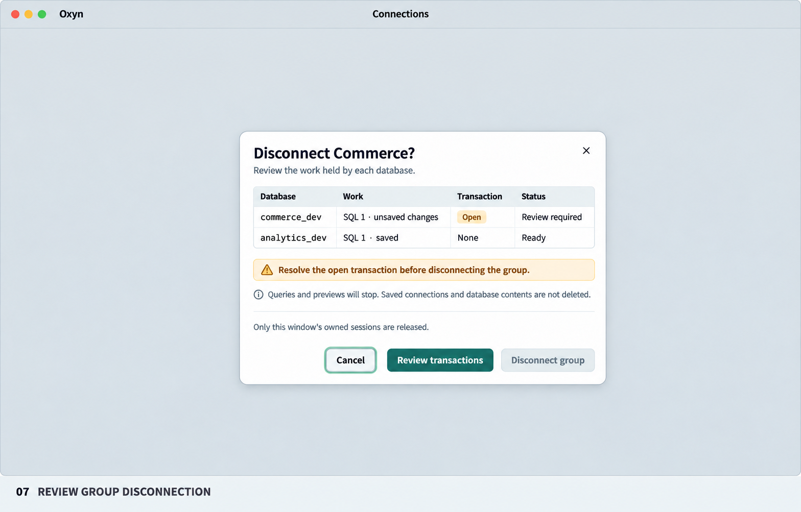
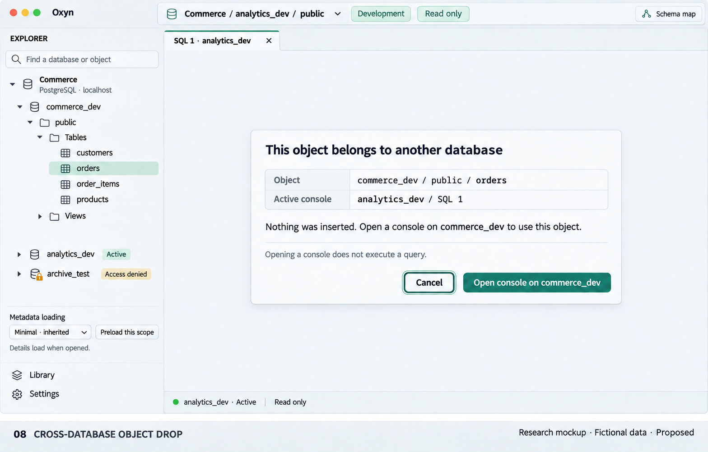

# Multi-base research: setup, switching and lifecycle mockups

**Status:** proposed static design. **Date:** 2026-11-13.
**Source reference:** `f456ff1`. This appendix extends the
[initial mockups](schema-research-mockups.md), the
[journeys](schema-research-journeys.md) and proposed
[ADR-0080](../adr/0080-group-database-connections-under-server-profiles.md).
No application code or interactive prototype is included.

## Reading order and ownership

The shared explorer selects a target; explicit activation reveals that base's
retained workspace. Its tabs, header, execution, inspector and assistant stay
owned by that connection. The proposal does not create a mixed-base tab strip.

The images use fictional names and independent UI states, not a recording of
one continuous interaction. In 04, Production is the initial default; 05 and
08 illustrate a connection explicitly configured as Development and read-only.
No automatic environment downgrade or inherited credential is implied.

| Screen | Journey | State to inspect |
|---|---|---|
| [03 — Add server profile](mockups/03-add-server-profile-v1.png) | J01 | Non-secret defaults plus an already authorized discovery connection |
| [04 — Open a database](mockups/04-open-database-v1.png) | J01 | Independent credential entry, protection review, empty first console |
| [05 — Switch retained workspace](mockups/05-switch-retained-workspace-v1.png) | J01/J06 | Two connected bases, one active; the other still holds a transaction |
| [06 — Scoped context menus](mockups/06-scoped-context-menus-v1.png) | J01/J02/J06 | Profile, base and object actions have different targets |
| [07 — Disconnect group review](mockups/07-disconnect-group-review-v1.png) | J09 | Transaction review blocks group disconnection; Cancel is focused |
| [08 — Cross-base object drop](mockups/08-cross-database-object-drop-v1.png) | J06 | Object selection does not change the active console destination |

## 03 — Add a server profile

This scene reuses an existing authorized connection as the seed. The alternate
Create a discovery connection entry leads to the ordinary connection flow;
it does not make discovery unauthenticated. Save profile and discover is an
explicit combined user request, not a network operation caused by editing a field.
The profile preview has no database count before the response.
TLS and advanced driver options are not expanded in this image; they remain
part of the reviewed destination, not omitted from its actual configuration.

## 04 — Open a discovered database

The active content remains commerce_dev while analytics_dev is reviewed.
No password is filled or copied from a sibling. Production is the cautious
default; a change follows the existing protection confirmation flow.
The disabled Open database button represents this fixture's missing credential,
not a rule that every driver always requires a password. Cancelling leaves
the current workspace intact. The first grouped console opens empty and runs nothing.

## 05 — Show another base's retained workspace

The header, tabs and context selector all name analytics_dev. Commerce remains
connected with an open transaction; Go to workspace explicitly activates it.
The count uses the existing per-window connection bound, not a limit on
discovered databases. The empty editor is an intentional state, not a failed
copy of commerce_dev's text.

## 06 — Separate menus by target

This is a component sheet with three independent menu examples, not three
simultaneous menus in the running application.
Discover/Edit/Disconnect group/Delete profile apply to the profile.
New console/Refresh/Edit connection/Disconnect apply to the named child.
Object reading and copying apply to the object's child and full address.
Rename and Drop are disabled in the read-only fixture.
Delete profile neither drops a database nor silently deletes saved children.

## 07 — Review group disconnection

The isolated dialog is shown on a neutral backdrop so no hidden header implies
a different active target. It lists the two affected bases and unsaved work.
Review transactions enters the existing per-session transaction flow; it does
not commit or roll back anything itself. Disconnect group remains disabled
until the required reviews are resolved. Cancel before confirmation closes nothing.
If an actual multi-child close later fails partway, the result must name the
children already closed; this static before-confirmation scene does not cover that outcome.

## 08 — Guard a cross-base insertion

The highlighted orders node belongs to commerce_dev, while analytics_dev is
active. This is deliberate selection-versus-activation, not a mismatched header.
Nothing was inserted. The offered action opens a console on the source base
without running SQL; Cancel keeps the current editor untouched.
Explicit Copy SQL to database remains a separate reviewed copy action, not an
automatic consequence of a drop. Delayed requests keep their original destination.

## Implementation impact to preserve in later work

| Current seam | Why the proposed UI needs a change |
|---|---|
| WorkspaceHost and WorkspaceScreen | Share explorer navigation without merging per-connection content ownership |
| CatalogSidebar and CatalogNode | Carry target ownership instead of applying every node action to the active workspace's connection |
| ConnectionScreen opening state | Track child openings and cancellation separately, with reserved capacity and late-response cleanup |
| useConsoles and openInConsole | Empty grouped openings; explicit, generation-bound text destinations |
| Connection settings and menus | Distinguish profile defaults, child settings, unlinking, disconnection and deletion |
| Window close and recovery | Preserve transactions, drafts and other windows' resources when a group closes |

The ADR links the inspected code. These are design requirements, not claims
that the missing paths exist. Settings propagation, unknown transaction states,
opening/cancelling, partial close failure, compact/dark layouts and accessibility
still need their acceptance scenarios. The ten journeys remain together because
they form one reviewable lifecycle; detailed visual rationale stays in this
appendix instead of extending that file with screen-by-screen specifications.

## Generation and visual checks

Created with built-in `image_gen`, using image 01 as the style reference.
[Generation and correction prompts](mockups/multi-base-generation-prompts.txt)
are preserved as English tool inputs. Only selected final PNGs are copied into
the worktree; the two earlier deliverables remain unchanged.

Visual review checked target names, active-versus-connected markers, blank
credentials, independent protections, empty console, disabled destructive or
blocked actions, the transaction review and the cross-base guard. Images remain
raster proposals: focus outlines illustrate intent, not a passed keyboard test;
spacing, exact tokens and icons require real-component validation later.
