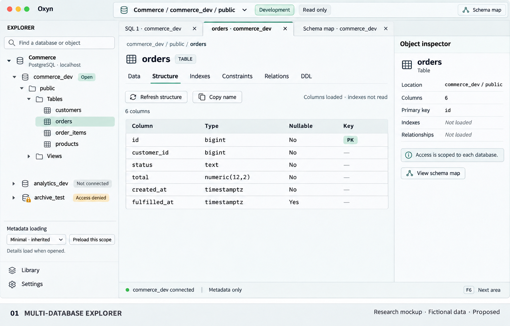
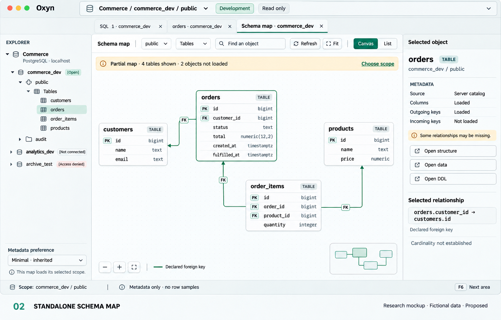

<!-- oxyn-translation source="docs/implementation-plan/schema-research-mockups.md" sha256="bd1d48a4e9f9" -->

# Recherche sur les schémas : maquettes de l'explorateur et de la carte

**Statut :** proposition graphique statique, ni implémentation ni contrat UI accepté.
**Date :** 2026-11-13. **Référence du dépôt :** `f456ff1`.
Cette annexe appartient au [plan d'implémentation](../IMPLEMENTATION-PLAN.md).
Les [parcours](schema-research-journeys.md) et la
[matrice des moteurs](schema-research-engines.md) portent toujours la recherche
sur les comportements.

## Livrables

| Image | Parcours / ADR proposé | Points à examiner |
|---|---|---|
| [01 — Explorateur multi-base](../../../../docs/implementation-plan/mockups/01-multi-database-explorer-v1.png) | J01/J02/J03/J10 ; ADR-0080/0080 | Regroupement serveur, états indépendants des bases, destination fixe des onglets et disponibilité distincte des métadonnées |
| [02 — Carte autonome des schémas](../../../../docs/implementation-plan/mockups/02-schema-map-v1.png) | J04/J06/J10 ; ADR-0082 | Périmètre explicite, liens typés, couverture partielle et inspection sans panneau IA |
| [03–08 — Cycle de vie multi-base](schema-research-multibase-mockups.md) | J01/J02/J06/J09 ; ADR-0080 | Configuration, identifiants enfant, changement de workspace, menus ciblés, fermeture de groupe et insertion entre bases |

Les libellés anglais, noms de bases, objets et états sont fictifs. Ce sont des
propositions en image, pas des captures d'un build Oxyn en fonctionnement.
Surfaces claires ardoisées, accent vert-de-gris et typographie compacte suivent
la direction du [thème actuel](../../../../apps/desktop/src/styles.css), sans
prendre l'ancien tableau Figma comme source d'implémentation. Typographie,
icônes, espacements et contrastes exacts restent à valider dans les vrais composants.

## 01 — Explorateur multi-base

- `Commerce` est un groupe serveur ; `commerce_dev` est la base ouverte.
  `analytics_dev` n'est pas connectée et `archive_test` est refusée.
  Un enfant refusé ne rend pas le groupe inutilisable et n'apparaît pas vide.
- Fil d'Ariane et onglets gardent `commerce_dev` visible. Les marqueurs
  Development et Read only concernent cette connexion active, pas tous les
  enfants de Commerce.
- Structure montre six colonnes de `public.orders`. Index et relations sont
  explicitement non chargés ; la clé primaire ne signifie pas que ces facettes
  ont été lues.
- `Minimal · inherited` est la préférence héritée de l'espace de noms
  sélectionné ; `Preload this scope` est une action distincte. Ouvrir Structure
  demande toujours sa description nécessaire.
- L'entrée de carte est accessible sans configurer de fournisseur IA. F6 est
  montré comme action proposée du workspace, pas comme preuve d'implémentation.

## 02 — Carte autonome des schémas

- Le périmètre est `commerce_dev / public`, avec le filtre Tables. Quatre
  objets dessinés et deux non chargés sont des comptes fictifs du périmètre
  choisi, pas une affirmation sur une base réelle ou complète.
- Exactement trois clés étrangères sont représentées :
  `orders.customer_id → customers.id`,
  `order_items.order_id → orders.id`,
  `order_items.product_id → products.id`.
  Les flèches pointent vers l'objet référencé ; aucune cardinalité n'est affirmée.
- L'objet orders sélectionné a les mêmes six colonnes que l'explorateur.
  Les cartes résument la structure ; points d'attache exacts des liens et focus
  par champ restent des détails d'interaction à valider, pas des relations exécutables.
- L'inspecteur distingue colonnes/clés sortantes chargées et clés entrantes non
  lues. Des liens entrants visibles grâce aux clés sortantes d'un autre objet ne
  démontrent pas une découverte exhaustive des liens entrants d'orders.
- Canvas/List, choix du périmètre, recherche, Fit et zoom sont des contrôles
  proposés. Open Data est une demande d'aperçu séparée ; sélectionner une carte
  ne lit aucune ligne.

## Limite de la revue

Les deux images initiales couvrent un affichage desktop clair et peuplé, avec des états
représentatifs d'indisponibilité et de couverture partielle. Elles ne démontrent
pas chargement, vide, authentification, dispositions compacte/sombre, clavier,
contenu de la liste accessible, export d'image ou rendus non relationnels.
Ces éléments restent dans les critères des parcours ; une icône ou un bouton
dessiné ne décide aucun nouveau comportement.

Les [six ajouts de cycle de vie](schema-research-multibase-mockups.md) illustrent
désormais saisie d'identifiants, console vide, activation, menus ciblés et revues
de fermeture/dépôt. Ce sont des propositions statiques, pas des tests
d'exécution ou d'accessibilité.

Les écrans partagent une cible et une direction visuelle ; les panneaux ont des
largeurs différentes pour laisser davantage d'espace à la carte. La génération
raster n'est pas une implémentation exacte des tokens ou de Hugeicons.
L'inspection visuelle a vérifié hiérarchie, noms cibles, cohérence des six
colonnes, trois liens, formulation de couverture partielle et lisibilité.
Aucun code applicatif ni base réelle n'a été utilisé.

## Trace de génération

Créées avec l'outil intégré `image_gen` après indisponibilité du transport
vers l'application Pencil. Les [prompts exacts de génération et retouches retenues](../../../../docs/implementation-plan/mockups/generation-prompts.txt)
sont conservés comme entrées d'outil en anglais, avec les rôles des images de
référence. Les originaux restent hors du dépôt ; seuls les deux PNG retenus
sont copiés ici. Aucun HTML, React, programme SVG ou prototype interactif créé.
