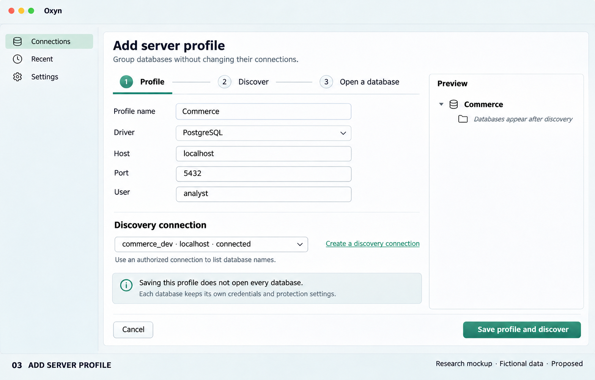
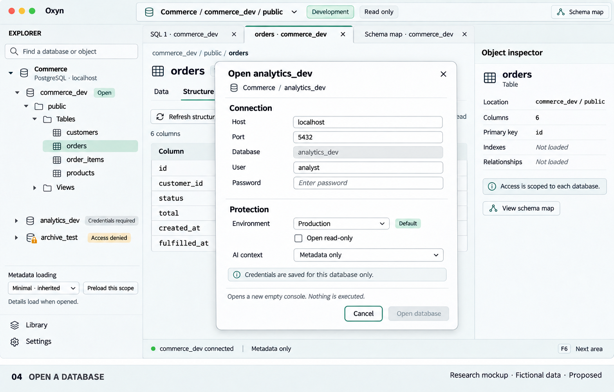
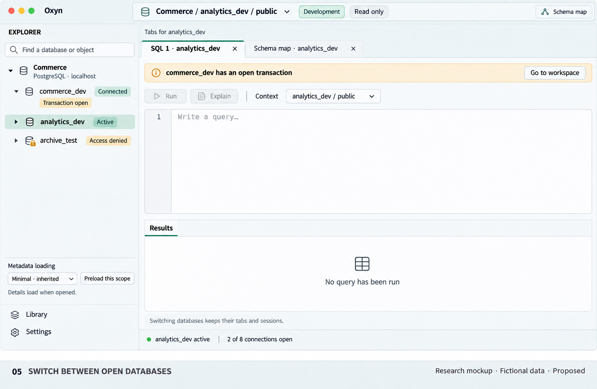
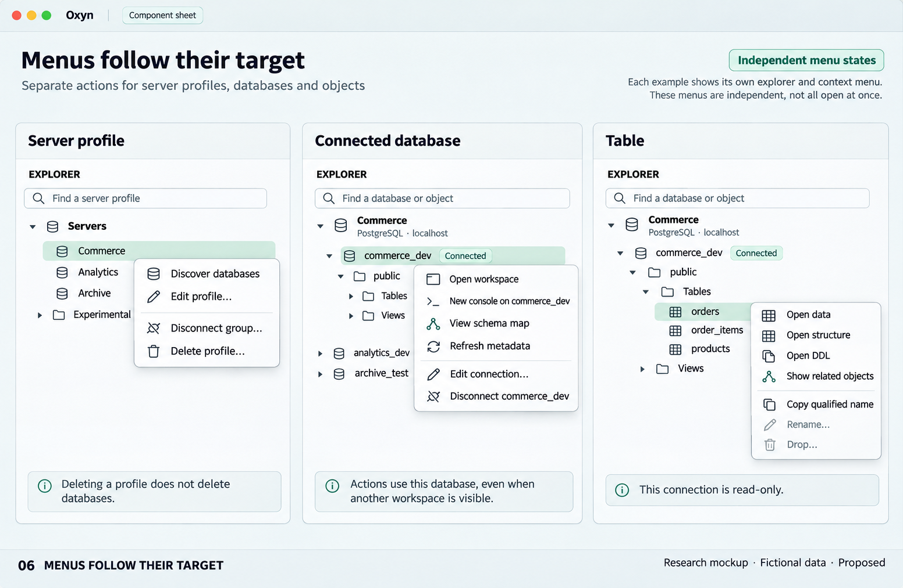
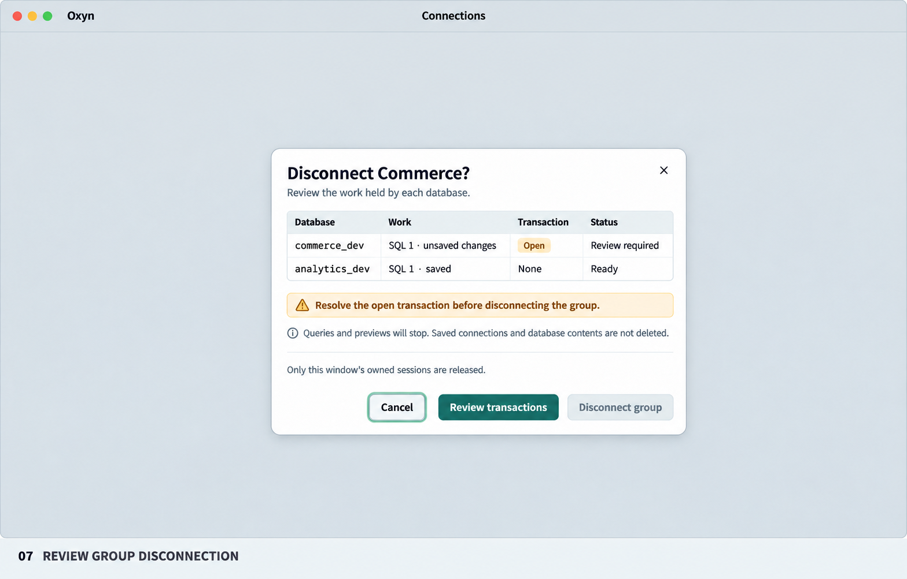
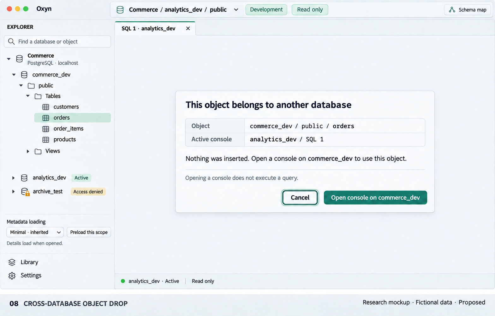

<!-- oxyn-translation source="docs/implementation-plan/schema-research-multibase-mockups.md" sha256="19099ef3d03f" -->

# Recherche multi-base : maquettes de configuration, navigation et cycle de vie

**Statut :** proposition graphique statique. **Date :** 2026-11-13.
**Référence du code :** `f456ff1`. Cette annexe complète les
[premières maquettes](schema-research-mockups.md), les
[parcours](schema-research-journeys.md) et
[l'ADR-0080 proposé](../adr/0080-group-database-connections-under-server-profiles.md).
Aucun code applicatif ni prototype interactif n'est inclus.

## Ordre de lecture et propriété

L'explorateur commun sélectionne une cible ; son activation explicite montre
le workspace conservé de cette base. Onglets, en-tête, exécution, inspecteur et
assistant restent la propriété de cette connexion. La proposition ne crée pas
de barre d'onglets mélangeant plusieurs bases.

Les images utilisent des noms fictifs et des états indépendants, pas
l'enregistrement d'une interaction continue. Dans 04, Production est la valeur
initiale ; 05 et 08 illustrent une connexion explicitement configurée en
Development et lecture seule. Aucun abaissement automatique d'environnement
ni héritage d'identifiants n'est sous-entendu.

| Écran | Parcours | État à examiner |
|---|---|---|
| [03 — Ajouter un profil serveur](../../../../docs/implementation-plan/mockups/03-add-server-profile-v1.png) | J01 | Valeurs non secrètes et connexion de découverte déjà autorisée |
| [04 — Ouvrir une base](../../../../docs/implementation-plan/mockups/04-open-database-v1.png) | J01 | Identifiants indépendants, revue des protections, première console vide |
| [05 — Changer de workspace conservé](../../../../docs/implementation-plan/mockups/05-switch-retained-workspace-v1.png) | J01/J06 | Deux bases connectées, une active ; l'autre garde sa transaction |
| [06 — Menus selon la cible](../../../../docs/implementation-plan/mockups/06-scoped-context-menus-v1.png) | J01/J02/J06 | Profil, base et objet ont des cibles d'action distinctes |
| [07 — Revoir la déconnexion du groupe](../../../../docs/implementation-plan/mockups/07-disconnect-group-review-v1.png) | J09 | La revue de transaction bloque la déconnexion ; Annuler a le focus |
| [08 — Dépôt d'objet entre bases](../../../../docs/implementation-plan/mockups/08-cross-database-object-drop-v1.png) | J06 | Sélectionner l'objet ne change pas la destination de la console active |

## 03 — Ajouter un profil serveur

Cette scène réutilise une connexion déjà autorisée comme point de départ.
Create a discovery connection mène au parcours de connexion ordinaire ; cela
ne rend pas la découverte anonyme. Save profile and discover est une demande
combinée explicite, pas un accès réseau déclenché en modifiant un champ.
L'aperçu du profil n'annonce aucun nombre de bases avant la réponse.
TLS et options avancées du driver ne sont pas développés sur cette image ;
ils restent dans la destination revue, pas absents de la configuration effective.

## 04 — Ouvrir une base découverte

Le contenu actif reste commerce_dev pendant la revue d'analytics_dev.
Aucun mot de passe n'est rempli ou copié d'une base sœur. Production est la
valeur prudente ; tout changement suit la confirmation de protection existante.
Open database désactivé représente l'identifiant manquant de cet exemple,
pas une obligation de mot de passe pour tous les drivers. Annuler conserve
le workspace courant. La première console groupée est vide et n'exécute rien.

## 05 — Montrer le workspace conservé d'une autre base

En-tête, onglets et sélecteur de contexte nomment tous analytics_dev.
Commerce reste connectée avec une transaction ouverte ; Go to workspace
l'active explicitement. Le compte reprend la limite existante de connexions
par fenêtre, pas une limite de bases découvrables. L'éditeur vide est un état
intentionnel, pas un échec de copie du texte de commerce_dev.

## 06 — Séparer les menus selon leur cible

C'est une planche de composants avec trois exemples indépendants, pas trois
menus simultanément ouverts dans l'application.
Discover/Edit/Disconnect group/Delete profile concernent le profil.
New console/Refresh/Edit connection/Disconnect concernent l'enfant nommé.
Lectures et copies d'objet concernent sa connexion et son adresse complète.
Rename et Drop sont désactivés dans cet exemple en lecture seule.
Delete profile ne supprime ni base serveur ni connexions enfants silencieusement.

## 07 — Revoir la déconnexion du groupe

Le dialogue isolé est présenté sur un fond neutre pour qu'aucun en-tête caché
ne suggère une autre cible active. Il liste les deux bases et le travail non
enregistré. Review transactions ouvre le parcours existant par session ; il ne
commit ni rollback par lui-même. Disconnect group reste désactivé jusqu'au
traitement des revues requises. Annuler avant confirmation ne ferme rien.
Si une fermeture réelle échoue à mi-chemin, son résultat doit nommer les
enfants déjà fermés ; cette scène avant confirmation ne couvre pas cette issue.

## 08 — Protéger une insertion entre bases

Le nœud orders sélectionné appartient à commerce_dev, tandis qu'analytics_dev
est active. Cette distinction sélection/activation est volontaire, pas un
en-tête incohérent. Rien n'a été inséré. L'action proposée ouvre une console
sur la base source sans exécuter de SQL ; Annuler conserve l'éditeur.
Copy SQL to database reste une action de copie explicite revue, pas la
conséquence automatique d'un dépôt. Les demandes tardives gardent leur cible.

## Impacts à conserver pour l'implémentation ultérieure

| Point de jonction actuel | Pourquoi l'interface proposée doit évoluer |
|---|---|
| WorkspaceHost et WorkspaceScreen | Partager la navigation sans mélanger la propriété des contenus par connexion |
| CatalogSidebar et CatalogNode | Porter la cible plutôt qu'appliquer chaque action à la connexion du workspace actif |
| État d'ouverture de ConnectionScreen | Suivre chaque enfant, réserver la capacité et nettoyer les réponses tardives |
| useConsoles et openInConsole | Ouvertures groupées vides ; destinations explicites liées à leur génération |
| Paramètres et menus de connexion | Distinguer valeurs du profil, paramètres enfant, détachement, déconnexion et suppression |
| Fermeture des fenêtres et récupération | Préserver transactions, brouillons et ressources des autres fenêtres |

L'ADR lie le code inspecté. Ce sont des exigences de conception, pas
l'affirmation que les chemins manquants existent. Propagation des paramètres,
transactions inconnues, ouverture/annulation, fermeture partielle, modes
compact/sombre et accessibilité restent à couvrir par leurs scénarios.
Les dix parcours restent ensemble car ils forment un cycle de vie examinable ;
les détails visuels sont dans cette annexe au lieu d'allonger les parcours
avec des spécifications écran par écran.

## Génération et vérification visuelle

Créées avec `image_gen` intégré, l'image 01 servant de référence visuelle.
Les [prompts de génération et correction](../../../../docs/implementation-plan/mockups/multi-base-generation-prompts.txt)
sont conservés comme entrées d'outil en anglais. Seuls les PNG finaux retenus
sont copiés dans le worktree ; les deux premiers livrables restent inchangés.

La revue visuelle a vérifié noms cibles, marqueurs actif/connecté, identifiants
vides, protections indépendantes, console vide, actions désactivées ou bloquées,
revue de transaction et protection entre bases. Les images restent des
propositions raster : le focus dessiné illustre une intention, pas un test
clavier réussi ; espacements, tokens et icônes exigent les vrais composants.
